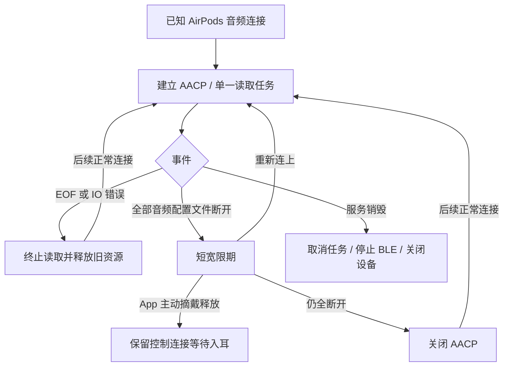
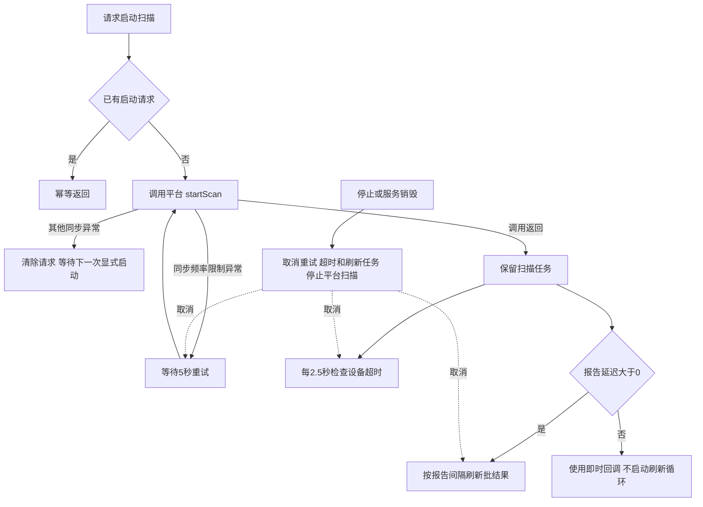
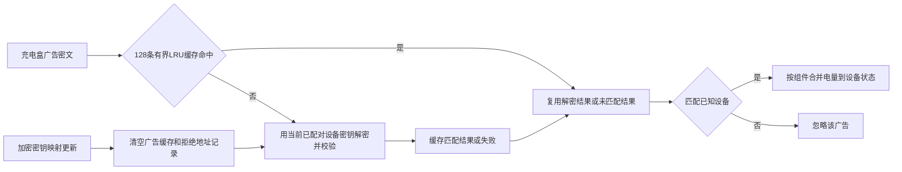

# LibrePods 2.0 自用修补版

用户已批准：在 YTWeng176/librepods 创建自己的分支，体验 2.0，优先稳定性修复与中文完善。设备为红米 K100 Pro Max、澎湃 4、AirPods 5、无 Root；现有 1.0.4 电量和降噪正常。

## 交付与边界

- 固定基线：上游 rewrite-v2.0.0-alpha.4，commit 80aa7461df414470f379ebdfe540b2e8889fcbe2。
- 分支 codex/librepods-v2-personal；独立应用 ID me.kavishdevar.librepods.personal，名称 LibrePods Personal；FOSS APK，以独立私钥签名。密钥仅保存在本地忽略目录及本 fork 的 Actions secret，不提交仓库。
- 保留现有 1.0.4 安装与数据。文档要求测试时只启用一个 LibrePods 后台服务，避免两实例争用耳机。
- 提供构建入口、变更来源、自动测试证据、手工验收清单；在自己的 fork 创建唯一 OPEN PR，不向上游发 PR。
- 不增加 Root/Xposed/Shizuku 要求；不合并未验证的特权服务、Miuix 大规模换肤、心率增强、系统空间音频或 Find My 原型。

## 功能契约

1. 断线读取：采用上游 PR #875 的 EOF/IOException 终止语义。重连不能遗留旧读循环或初始化任务，畸形数据包不会终止整个读取。回归测试覆盖 EOF、读异常、重复连接与取消。
2. 对话感知：采用 PR #855 的音量上限和过期渐变取消语义；说话时不高于会话前音量；状态从 2 开始也能恢复。测试低音量及交错渐变。
3. BLE 耗电：调查 #911，不声称 #875 能修复全部耗电。扫描 start/stop 必须幂等；报告延迟为零时不能零延迟 flush 空转；重启扫描应恢复超时清理；服务销毁不留扫描/重试任务。对重复充电盒广告做有界处理，避免每条广播重复解密无变化数据；缓存失效覆盖密钥变化。仅在有可核验证据时声称修复，对无法真机证实的耗电改善明确标为待验收。
4. 尊重断开：调查 #921。Android 音频配置文件全断开后，经短宽限期关闭该设备 AACP，取消同设备待处理任务，防止保持控制连接把耳机拉回。LibrePods 因摘戴检测主动暂时释放音频时仍保留恢复逻辑；正常手动重新连接应恢复控制。只对已知设备处理，不扫描或改变其他蓝牙设备。
5. 中文：采用 PR #852；处理与所选基线冲突，保留新键和占位符，不覆盖其他语言。修正通透 EQ 标签裁切。来源保留作者归属。
6. 弹窗：从 #881 仅移植窗口状态先设置再添加窗口、已存在窗口更新参数等裁切修复，不改变整套动画及默认外观。
7. 来电手势：核对 #821 与 2.0 实现；仅存在同一低采样率平滑缺陷时移植修复，并提供慢/快采样回归测试。

## 连接生命周期

普通摘戴副作用要求控制连接有效且本机仍有音频连接许可；任一音频配置文件开始断开时即撤销普通许可，先前由 App 主动摘戴释放而保留的许可除外。新的 CONNECTING/CONNECTED 事件恢复本机许可，全部配置文件断开后的宽限只负责控制连接清理。

## 验证标准

### 扫描取消与广告缓存

平台 `onScanFailed` 异步失败后的自动恢复不在本次移植范围；调用返回不代表硬件扫描已成功，此边界需真机检查。

- 运行针对性 JVM 回归测试、资源校验和 FOSS APK 编译；安装包包名、签名、版本可核验。
- 本机无 Android SDK/JDK，需准备本地工具链或使用 fork 的标准 GitHub 托管 runner；不使用上游私有构建 runner、发布密钥或 Play/Discord 凭据。
- 独立 PR 审查优先按用户要求调用 mac-mini 上 Claude；不可用自动 Codex 接手。实际审查者与版本公开。
- 没有用户真机时，不声称降噪、通话、头部手势、耗电等端到端硬件验收通过。
